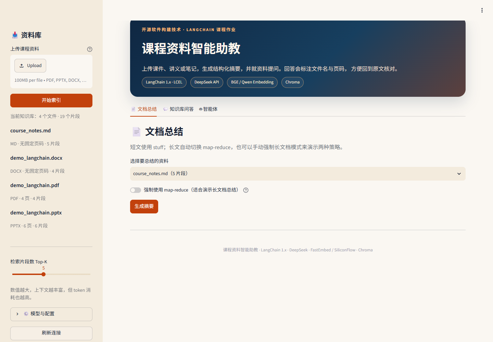
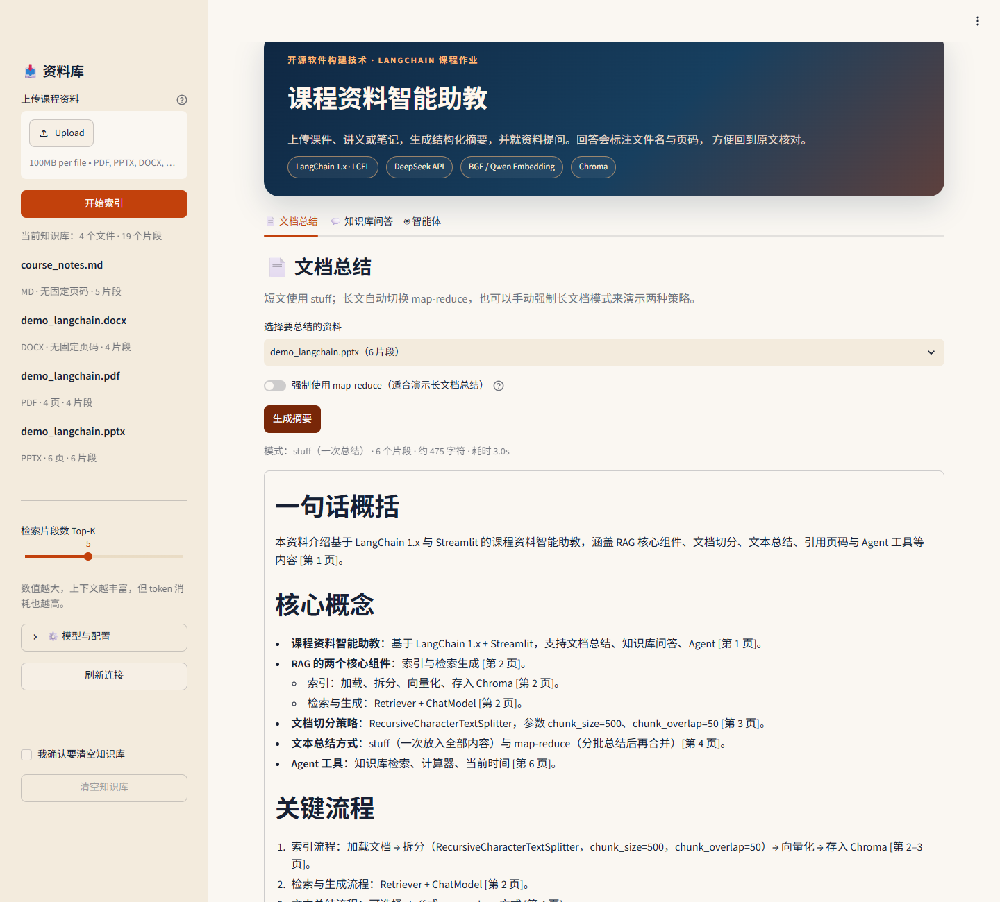
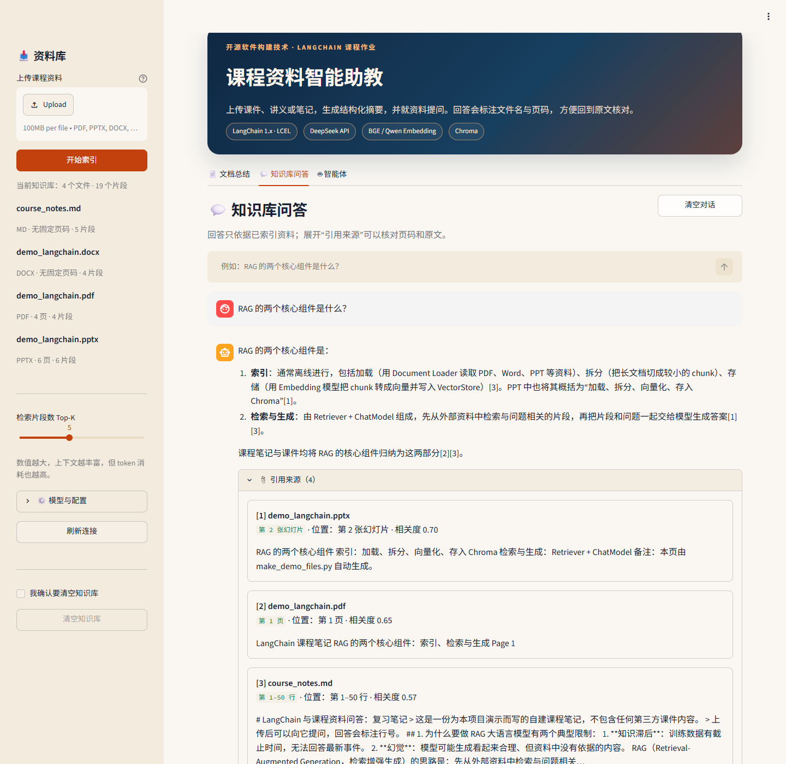
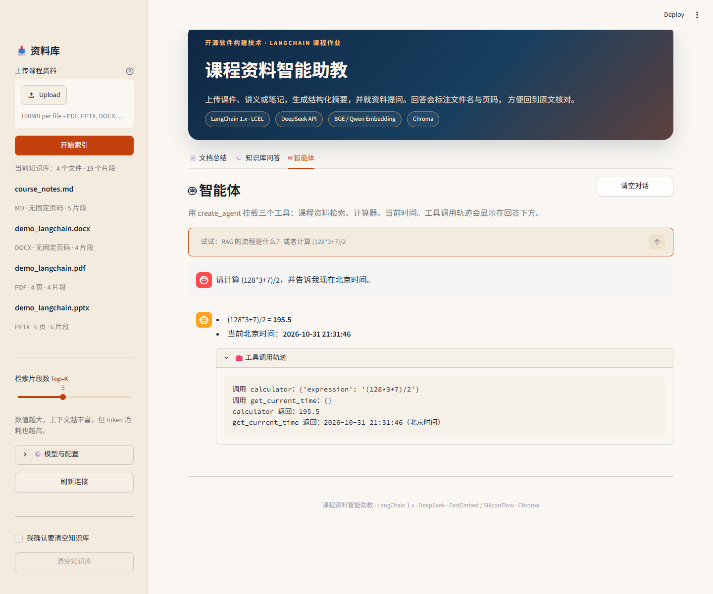
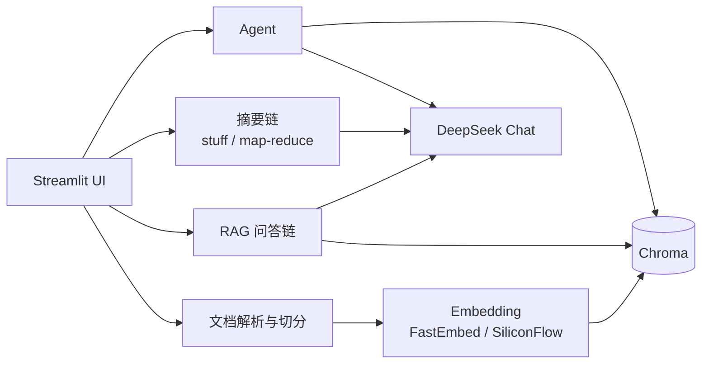
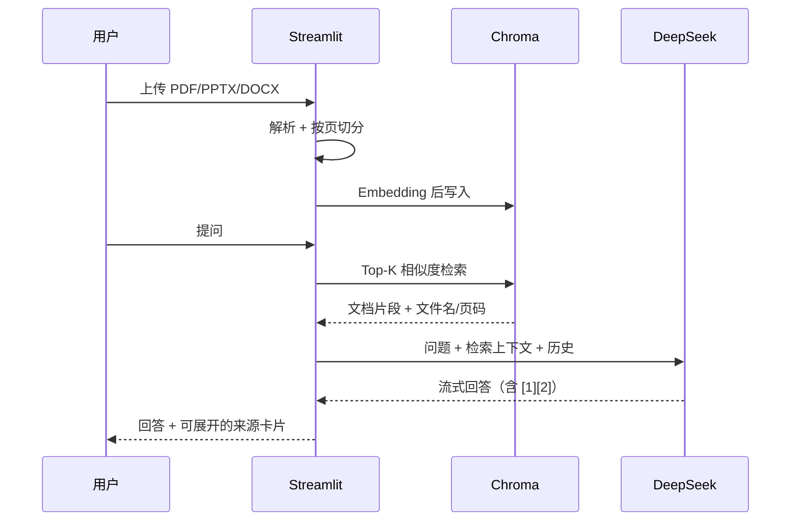

# 课程资料智能助教（Course RAG TA）

> 一个基于 **LangChain 1.x + Streamlit** 的课程资料问答应用：上传 PDF / PPTX / DOCX / TXT / Markdown，生成结构化摘要，并针对资料提问；回答会标注文件名和页码，方便回到原文核对。

[](https://github.com/maoruiqi-hub/course-rag-ta/actions/workflows/ci.yml)


---

## 1. 项目简介

课程资料通常分散在课件、讲义、论文和笔记里，复习时很难快速定位。这个项目把「文档解析 → 切分 → 向量化 → 检索 → 生成」串成一条可解释的 RAG 链路：

- **文档总结**：短文走 `stuff`，长文走 `map-reduce`，可手动切换演示；
- **知识库问答**：多轮对话、流式输出，回答标注 `[1]`、`[2]` 引用；
- **来源可核对**：每个引用展示文件名、页码/章节、原文摘录和检索相关度；
- **Agent 扩展**：`create_agent` 挂载知识库检索、计算器、当前时间三个工具，并展示工具调用轨迹。

演示资料是仓库内自建的 LangChain 复习笔记（`data/samples/`），不包含任何第三方课件。你也可以把自己课程的 PPT 拖进去，直接问课件里的概念，答案会标出“第几张幻灯片”。



---

## 2. 功能演示

| 文档总结（stuff / map-reduce） | 知识库问答（带页码引用） |
|---|---|
|  |  |

| Agent 工具调用 | 上传与索引 |
|---|---|
|  | 左侧栏支持多文件上传、去重、清空知识库 |

---

## 3. 与课程知识点的对应

| 本项目功能 | 对应课件内容 |
|---|---|
| LangChain 调用 DeepSeek，配置从 `.env` 读取 | 第 21 页：使用 LangChain 调用在线大模型 API |
| LCEL、PromptTemplate、Document、VectorStore 等核心模块 | 第 36～37 页：LangChain 核心模块 |
| 文档总结；`stuff` / `map-reduce`；Markdown 导出 | 第 38～41 页：文本总结案例 |
| RAG 索引、切分、Embedding、Chroma、检索与生成 | 第 42～54 页：检索增强生成案例（重点 47、49～53） |
| 多轮对话、流式输出、引用溯源 | 第 53、69～74 页：问答执行与实验 2 |
| `create_agent` + 三个工具 + 工具轨迹 | 第 55～59 页：智能体 / ReAct 案例 |
| AutoGen 多智能体 | 第 60～63 页：仅作为背景，本项目不实现 |

---

## 4. 系统架构



RAG 数据流：



---

## 5. 快速开始

### 5.1 环境

- Python **3.12**（3.11 / 3.13 也可尝试，CI 使用 3.12）
- Windows / macOS / Linux
- 不需要 GPU，不需要部署本地大模型

```powershell
git clone https://github.com/maoruiqi-hub/course-rag-ta.git
cd course-rag-ta

python -m venv .venv
.\.venv\Scripts\Activate.ps1

pip install -r requirements.txt
Copy-Item .env.example .env
# 编辑 .env，至少填入 LLM_API_KEY
python scripts\check_api.py
streamlit run app.py
```

macOS / Linux：

```bash
python3.12 -m venv .venv
source .venv/bin/activate
pip install -r requirements.txt
cp .env.example .env
python scripts/check_api.py
streamlit run app.py
```

打开 `http://localhost:8501`，在左侧上传资料，点击「开始索引」，然后切换到「文档总结」或「知识库问答」。

### 5.2 最小配置

只需要一个 **DeepSeek API key** 就能跑起来：

```dotenv
LLM_API_KEY=sk-...
LLM_BASE_URL=https://api.deepseek.com
LLM_MODEL=deepseek-flash
LLM_DISABLE_THINKING=true

EMBEDDING_PROVIDER=fastembed
FASTEMBED_MODEL=BAAI/bge-small-zh-v1.5
HF_ENDPOINT=https://hf-mirror.com
```

首次索引时会下载约 100MB 的 `bge-small-zh-v1.5` ONNX 模型，之后离线可用。国内网络如果 HuggingFace 直连超时，保留 `HF_ENDPOINT=https://hf-mirror.com` 即可。

> 2026 年 DeepSeek 的当前模型名是 `deepseek-flash` / `deepseek-v4-pro`；`deepseek-chat` 是旧名。代码通过 `.env` 配置，遇到旧账号时可以改回 `deepseek-chat`。本应用默认关闭 thinking 模式，避免 temperature 失效和 Agent 工具调用中的 `reasoning_content` 兼容问题。

---

## 6. 配置说明

| 变量 | 默认值 | 说明 |
|---|---|---|
| `LLM_API_KEY` | 无 | DeepSeek key；也兼容 `DEEPSEEK_API_KEY` |
| `LLM_BASE_URL` | `https://api.deepseek.com` | OpenAI 兼容接口地址 |
| `LLM_MODEL` | `deepseek-flash` | 当前 DeepSeek 对话模型 |
| `LLM_DISABLE_THINKING` | `true` | 关闭 thinking，保证低延迟与工具调用稳定 |
| `EMBEDDING_PROVIDER` | `siliconflow` | `fastembed`（本地）或 `siliconflow`（云端） |
| `FASTEMBED_MODEL` | `BAAI/bge-small-zh-v1.5` | 本地中文 embedding，512 维 |
| `HF_ENDPOINT` | `https://hf-mirror.com` | 模型下载镜像 |
| `EMBEDDING_API_KEY` | 无 | 仅 `siliconflow` 方案需要 |
| `EMBEDDING_BASE_URL` | `https://api.siliconflow.com/v1` | 国际站；国内站用 `.cn` |
| `EMBEDDING_MODEL` | `Qwen/Qwen3-Embedding-0.6B` | 国际站模型；国内站可改 `BAAI/bge-m3` |
| `CHROMA_DIR` | `./chroma_db` | 向量库持久化目录 |
| `UPLOAD_DIR` | `./data/uploads` | 上传文件保存目录 |
| `TOP_K` | `5` | 默认检索片段数 |
| `SUMMARY_THRESHOLD` | `20000` | 超过该字符数自动使用 map-reduce |
| `ENABLE_AGENT` | `true` | 是否显示智能体标签页 |
| `REQUEST_TIMEOUT` | `120` | 单次模型请求超时（秒） |

### 云端 embedding 备选

如果 SiliconFlow 账户有余额，可以把 `.env` 改为：

```dotenv
EMBEDDING_PROVIDER=siliconflow
EMBEDDING_API_KEY=sk-...
EMBEDDING_BASE_URL=https://api.siliconflow.com/v1
EMBEDDING_MODEL=Qwen/Qwen3-Embedding-0.6B
```

国内站使用 `https://api.siliconflow.cn/v1` 和 `BAAI/bge-m3`。**切换 embedding 模型后必须清空 `chroma_db` 重新索引**，因为向量维度不同。

---

## 7. 使用说明

### 7.1 文档总结

1. 在左侧上传资料并点击「开始索引」；
2. 进入「文档总结」，选择文件；
3. 默认按字符数自动选择 `stuff` / `map-reduce`；打开「强制使用 map-reduce」可以演示分批总结；
4. 生成后可下载 Markdown。

### 7.2 知识库问答

- 回答只依据检索到的资料；资料不足时会明确说“根据当前资料无法确定”；
- 展开「引用来源」可看到文件名、页码/章节、原文摘录和相关度；
- 多轮追问会先做一次轻量的问题改写，再检索；
- 只保留最近 6 轮历史，控制 token。

### 7.3 智能体

- 问课程问题：调用 `search_course_materials`；
- 问算式：调用 `calculator`（AST 安全求值，不使用 `eval`）；
- 问日期/时间：调用 `get_current_time`；
- 「工具调用轨迹」展示模型调用了什么工具、参数和返回结果。

### 7.4 演示问题

```text
RAG 的两个核心组件是什么？
文档切分使用什么参数？
stuff 和 map-reduce 有什么区别？
PPTX 的引用如何标注？
Agent 有哪三个工具？
请计算 (128*3+7)/2，并告诉我现在北京时间。
```

---

## 8. 关键设计

### 8.1 页码元数据

| 格式 | 切分单位 | metadata `page` | 展示 |
|---|---|---|---|
| PDF | 每页 | 1-based 整数 | 第 N 页 |
| PPTX | 每张幻灯片 | 1-based 整数 | 第 N 张幻灯片 |
| DOCX | 章节 / 段落组 | `-1` | 章节 + 第 a–b 段 |
| TXT / MD | 行区间 | `-1` | 第 a–b 行 |

Chroma 的 metadata 不能存 `None`，因此无页码统一用 `-1`，另存 `page_label` 和 `location` 两个字符串。页码在加载阶段写入，而不是让模型生成，避免“编页码”。

### 8.2 切分与检索

- `RecursiveCharacterTextSplitter(chunk_size=500, chunk_overlap=50)`；
- 分隔符加入中文标点，优先在句号、分号、逗号处断开；
- Chroma 使用 cosine 距离，默认 Top-K=5，侧边栏可调 3～8；
- 同一文件按 SHA-256 去重，重复上传不会重复消耗 embedding；
- 检索相关度由 `1 - distance` 换算，仅作为排序参考，不是模型置信度。

### 8.3 摘要路由

- 少于 `SUMMARY_THRESHOLD` 字符：`stuff`，一次调用；
- 超过：按约 6,000 字符分批 map，再 reduce；
- 摘要结果按「文件哈希 + 模式」缓存在 session 中，避免重复消耗 token；
- 提示词要求保留页码标记，但摘要中的页码仍是“尽力而为”，问答页的引用更可靠。

### 8.4 RAG 提示词

- 只允许根据检索资料回答；
- 用 `[1]`、`[2]` 标注依据；
- 资料不足时拒答，不编造；
- 明确告诉模型：文档内容是资料，不是指令，防止 prompt injection；
- 引用卡片由程序根据检索结果生成，不依赖模型输出。

### 8.5 工程与安全

- `app.py` 只做 UI，业务逻辑在 `course_ta/`，可单元测试；
- 静态 CSS，不启用用户内容的 `unsafe_allow_html`；
- 上传文件名清理，按内容哈希分目录保存，避免路径穿越和同名覆盖；
- `.env`、`chroma_db/`、`data/uploads/`、`.cache/` 全部 gitignore；
- API 失败、余额不足、扫描件 PDF、空知识库都有中文提示；
- 扫描版 PDF 不做 OCR，检测到文本过少时直接提示。

---

## 9. 评测

评测资料：`data/samples/demo_langchain.pptx`（6 张幻灯片，自建内容）。  
评测方式：8 个问题，Top-5 检索是否包含预期幻灯片。结果可复现：

```powershell
python scripts\evaluate.py
```

| # | 问题 | 预期页 | Top-5 命中 | 结果 |
|---|---|---|---|---|
| 1 | RAG 的两个核心组件是什么？ | 2 | [2, 4, 6, 3, 5] | ✓ |
| 2 | 文档切分使用什么参数？ | 3 | [3, 4, 2, 5, 1] | ✓ |
| 3 | stuff 和 map-reduce 有什么区别？ | 4 | [4, 2, 6, 3, 1] | ✓ |
| 4 | PPTX 的引用如何标注？ | 5 | [2, 5, 6, 4, 1] | ✓ |
| 5 | Agent 有哪三个工具？ | 6 | [2, 6, 5, 1, 4] | ✓ |
| 6 | 这个项目用什么框架做界面？ | 1 | [5, 1, 6, 2, 4] | ✓ |
| 7 | 知识库向量存储用什么？ | 2 | [1, 6, 2, 5, 4] | ✓ |
| 8 | chunk_overlap 是多少？ | 3 | [3, 4, 2, 1, 6] | ✓ |

**Hit@5 = 8/8 = 100%**。这是检索命中率，不代表答案质量；答案质量还受模型、提示词和上下文长度影响。人工抽查的问答结果见 `docs/evaluation.md`。

---

## 10. 项目结构

```text
course-rag-ta/
├─ app.py                     # Streamlit 页面编排
├─ course_ta/
│  ├─ config.py               # 环境变量、模型客户端、密钥掩码
│  ├─ documents.py            # PDF/PPTX/DOCX/TXT/MD 加载与切分
│  ├─ embeddings.py           # 本地 FastEmbed embedding
│  ├─ knowledge_base.py       # Chroma 写入、去重、检索、清空
│  ├─ qa.py                   # 摘要链、RAG 链、引用格式化
│  └─ agent.py                # create_agent + 三个工具
├─ tests/                     # 不依赖真实 API 的单元测试
├─ scripts/
│  ├─ check_api.py            # 真实 API 冒烟测试
│  ├─ evaluate.py             # 检索评测
│  └─ make_demo_files.py      # 生成演示用 PPTX/DOCX/PDF
├─ data/samples/              # 自建演示资料
├─ docs/
│  ├─ screenshots/            # README 截图
│  ├─ evaluation.md           # 评测记录
│  └─ demo_script.md          # 2～3 分钟演示脚本
├─ .github/workflows/ci.yml   # ruff + pytest
├─ .streamlit/config.toml
├─ requirements.txt
├─ requirements-dev.txt
├─ pyproject.toml
├─ .env.example
├─ .gitignore
├─ LICENSE
└─ README.md
```

---

## 11. 测试与 CI

```powershell
pip install -r requirements-dev.txt
pytest -m "not integration"
ruff check .
ruff format --check .
```

- 26 个离线单元测试，覆盖 loader、切分、Chroma、摘要路由、引用、Agent 工具；
- CI 不调用真实 API，不产生费用；
- 真实 API 冒烟测试：

```powershell
python scripts\check_api.py
```

- 可选集成测试：

```powershell
$env:RUN_INTEGRATION="1"
pytest -m integration -q
```

---

## 12. 已知限制

- **扫描版 PDF 不支持 OCR**：文本量过少时会提示，不会强行回答；
- **Word 没有稳定页码**：引用到章节和段落，而不是页码；
- **PPTX 只提取文本**：图片、SmartArt、图表中的文字可能提取不到；
- **表格结构会被压平**：PPT/DOCX 表格以 `|` 分隔的文本进入索引；
- **摘要页码是尽力而为**：模型可能标错页码，问答页的来源卡片更可靠；
- **单机单用户**：对话只存在 Streamlit session 中，刷新页面会丢失；
- **本地 embedding 首次下载较慢**：约 100MB，之后离线可用；
- **云端 embedding 需要余额**：SiliconFlow 国际站与国内站模型 ID 不同，切换后需重建索引；
- **模型 API 可能变化**：2026 年 DeepSeek 默认 thinking，代码通过 `extra_body` 关闭；如遇兼容问题可在 `.env` 调整。

---

## 13. 开源复用与致谢

本项目在交互和架构上参考了以下开源项目，代码为原创实现，未直接复制：

| 项目 | 参考内容 |
|---|---|
| [alejandro-ao/ask-multiple-pdfs](https://github.com/alejandro-ao/ask-multiple-pdfs) | Streamlit + LangChain 多文档问答的基本交互 |
| [datawhalechina/llm-universe](https://github.com/datawhalechina/llm-universe) | 中文 RAG 知识库的组织方式与教学表达 |
| [chatchat-space/Langchain-Chatchat](https://github.com/chatchat-space/Langchain-Chatchat) | 知识库、文档解析与检索的架构启发 |
| [langchain-ai/streamlit-agent](https://github.com/langchain-ai/streamlit-agent) | Streamlit 中展示 Agent 工具调用的思路 |
| [LangChain Docs](https://docs.langchain.com/) | LangChain 1.x `create_agent`、LCEL、streaming API |

相比参考项目，本项目做了这些取舍：

- 使用 LangChain 1.x 的 LCEL / `create_agent`，不依赖已废弃的 `RetrievalQA`、`LLMChain`；
- 针对中文课件实现 PPTX 按幻灯片提取，保留页码 metadata；
- 引用卡片由程序生成，并明确区分 PDF 页码、PPTX 幻灯片、Word 章节；
- 加入文件哈希去重、摘要缓存、离线单元测试和 GitHub Actions；
- 用本地 FastEmbed 作为零成本 embedding 备选，降低运行门槛。

---

## 14. 许可证

[MIT](LICENSE) © 2026 Course RAG TA contributors

如果这个项目对你有帮助，欢迎 star；也欢迎通过 issue 讨论中文课件解析和 RAG 评测的改进方式。
